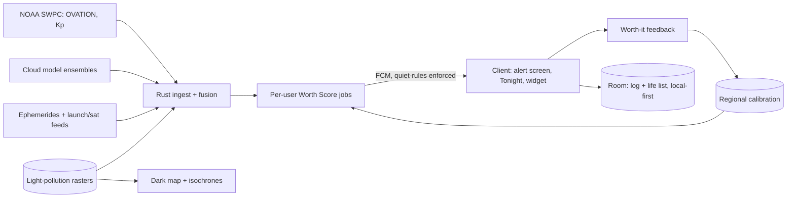

# Umbra — never sleep through the sky again

The aurora came south last year — visible from rooftops in cities that hadn't seen it in twenty years — and most people found out the next morning, from other people's photos, with the specific sting of a once-a-decade thing missed by eight hours of sleep. The information existed. The apps existed. But they were built for space-weather hobbyists: Kp-index charts, cloud-cover grids, notification storms that cry wolf about auroras you can't see from where you actually are. Umbra's entire product is one promise: **when your phone buzzes, go outside — it will be worth it.** Auroras, meteor showers, eclipses, ISS passes, comets, rocket launches: fused with *your* location, *your* cloud forecast, *your* light pollution, and *your* willingness to be woken — so a notification means "now, here, you," or it doesn't come at all.

## 1. Overview
- **Elevator pitch:** A dark-sky events companion built around a trustworthy alert engine: it fuses event ephemerides, geomagnetic and cloud forecasts, moon phase, and light pollution into a single per-user "worth going outside" score with strict notification discipline. Plus a darkness finder (the best truly dark sky within your drive time), a tonight-at-a-glance widget, an observation log with life lists, and star-party meetups for the big nights.
- **Category:** Science / Outdoors — astronomy & sky events.
- **Tagline:** *Never sleep through the sky again.*
- **Play Store positioning:** "Aurora, meteors, eclipses — alerts tuned to your sky, your clouds, your sleep. When it buzzes, go."

## 2. Problem & Why Now
Sky events have a last-mile problem. The data is public and superb — NOAA space weather, precise ephemerides, cloud models, VIIRS light-pollution measurements — but the consumer layer fails at the only question that matters: *should I, specifically, get up right now?* Aurora apps blast global Kp alerts (a Kp7 means nothing under overcast, and less in a light-flooded city); astronomy apps are planetarium encyclopedias (superb at "what's that star," silent at "wake me if it's worth it"); weather apps know clouds but not events. The result is learned helplessness: people disable alerts after two false alarms, then miss the real one. Why now: solar maximum is *here* — the current cycle peaked stronger than forecast and aurora visibility at unusual latitudes will keep recurring through the next couple of years, each event minting a wave of regret-driven installs (the "I missed it" cohort is the largest acquisition moment this category will ever have, and it is happening now); dark-sky tourism boomed into a real travel segment (DarkSky-certified parks tripled over a decade); and phone astrophotography (Pixel/Samsung night modes) turned "go look" into "go capture," giving every successful alert a shareable payoff. Nobody owns trust in this category. Trust is the entire product.

## 3. Target Audience & Personas
- **Elin, 34, teacher, Gothenburg.** Latitude-blessed, alert-fatigued. Every aurora app she's tried cried wolf until she muted it — then she missed October's storm. Umbra's first true positive (a 2:10am buzz, a 9/10 score, a sky on fire) converts her permanently; its silence on the cloudy Kp6 the next week is what makes her recommend it.
- **Marcus, 45, engineer and new telescope owner, Denver.** Wants the *practical* layer: when is it worth driving 40 minutes to dark sky for the Perseids versus watching from the yard? The darkness finder's drive-time isochrones and the "yard vs. dark site" comparison ("meteors/hour: ~15 vs. ~60") are built for exactly his Tuesday-night calculus.
- **Ava, 27, content creator, Manchester.** Chases skies for her channel; needs lead time (aurora probability windows hours ahead, launch visibility corridors) and location scouting (dark spots with foreground interest). She's the sharing engine: every capture credits the buzz that woke her.

## 4. Core Concept Deep-Dive
**The Worth Score is the invention.** Every candidate event-moment gets a 0–10 score for *this user, this location, this hour*: event magnitude (storm strength at your geomagnetic latitude, meteor ZHR, pass brightness) × sky transparency (cloud forecast, seeing) × darkness (sun/moon geometry, your measured light pollution — VIIRS data at your exact spot) × logistics (is it 3am? how long is the window? is tomorrow a workday — user-set quiet rules). The score's components are always shown — "9/10: strong storm (G3), clear north horizon, new moon; from your rooftop, look north 2–4am" — because explainable scores build calibrated trust, and calibrated trust is what keeps notifications enabled (the entire business rides on this loop; it is Sway's two-second covenant translated to the sky).

**Notification discipline as sacred law.** Users set thresholds per event class and per severity ("wake me above 8; notify quietly above 6; never on weeknights below 9") with sensible defaults; Umbra's internal rule is harder: *false-wolf rate is the north-star metric*, tracked via post-alert feedback ("was it worth it?" — one tap, next morning). An alert that flops triggers model review. The app would rather miss a marginal event than burn a user's 2am trust — and says so in onboarding, out loud, as a promise. Alert types: **Go Now** (the sacred wake-up — rare by design), **Get Ready** (2–6h lead: "aurora window likely tonight 11pm–3am, decide by 10"), **This Week** (planning digest, Sunday evening: the week's sky in 60 seconds), and **Once in a Lifetime** (eclipse paths, great comets — months of lead, travel-planning framed).

**The darkness finder answers "where."** From your location: drive-time isochrones over the light-pollution atlas → ranked real spots (pull-offs, parks, DarkSky sites — seeded from open data + community verification, the Doorway trust pattern lightly applied): each with Bortle estimate, horizon notes (crowdsourced: "open north view — good aurora spot"), safety basics (parking, cell coverage), and a "tonight here" score. The yard-vs-site comparison quantifies the drive's payoff. For city users — most users — this feature converts despair ("Bortle 8, why bother") into agency ("Bortle 4 is 35 minutes away, and Saturday is new moon").

**Tonight, always one glance away.** The widget answers the nightly question: a sky strip showing tonight's best hour, moon phase, cloud odds, any active event ("ISS 21:44, bright pass WSW→ENE" / "quiet sky — but Jupiter's fine from the balcony"). Quiet nights get honest modesty; the widget never hypes (the anti-cry-wolf discipline extended to ambient surfaces).

**The log and the life list make it a practice.** One-tap observation logging after any alert or session (what, where, conditions auto-attached, photo attach, one-line note — the Detour journal instinct); the **life list** turns phenomena into a naturalist's quest: aurora ✓ (three times), total solar eclipse ☐, Milky Way core ✓, fireball ☐, noctilucent clouds ☐, zodiacal light ☐… Each entry stores its full context ("aurora #3: G4, Bortle 4 site, with Dad"). The life list is the retention spine between events — and the eclipse-trip planning funnel.

**Star parties (v1.x), lightly.** For big nights (meteor peaks, storms), opt-in local gatherings at verified dark spots: RSVP, a host (Trusted-tier user or org — astronomy clubs are thrilled to list), and nothing else — no feed, no chat beyond logistics (the portfolio's no-feed spine). Astronomy clubs get free listing tools; they bring telescopes and welcome; Umbra brings the crowd and the timing.

## 5. Complete Feature Set
**MVP (v1.0):**
- Alert engine: aurora (NOAA OVATION + geomagnetic latitude modeling), meteor showers (ZHR + radiant altitude + moon interference), ISS/bright satellite passes, lunar/solar eclipses, visible rocket launches (corridor-aware for major sites), conjunctions/comets (curated); per-class thresholds, quiet rules, the four alert types, post-alert feedback loop.
- Worth Score with visible components; Tonight screen + widget; 7-day sky outlook.
- Darkness finder: light-pollution map (VIIRS-derived), drive-time isochrones, spot directory (open-data seeded), yard-vs-site comparison.
- Observation log + life list with auto-context; aurora photography quick-guide (per-phone night-mode cheat sheets — the capture payoff, served).
- Offline resilience: tonight's data cached by evening; alerts computed server-side, delivered push.
**v1.x fast-follows:**
- Star parties + club tools; community spot verification (horizon notes, Bortle confirmations — Doorway-lite trust mechanics).
- Once-in-a-Lifetime planner: eclipse-path explorer with date/place/weather-history ("odds of clear sky in Mazatlán that week: 72%"), trip checklists.
- Wear OS: the 2am buzz on the wrist with the score + direction; AOD moon/tonight complication.
**v2.0+:**
- Aurora nowcasting refinement via opt-in user confirmations ("seeing it? tap") — live ground-truth improving everyone's model within minutes (the network effect, earned honestly).
- Astro-photo mode integrations (exposure suggestions per event/phone); NLC and airglow alerts for the connoisseurs.
- Family/education pack: classroom-safe event calendars, "wake the kids?" advisory tier (a real parenting decision the app can own charmingly).

## 6. Screen-by-Screen UX Walkthrough
Navigation: bottom bar — **Tonight**, **Events**, **Dark Map**, **Log**, settings behind the avatar. Night-first design: the app defaults to a true-black, red-shifted night mode after dusk (astronomer's courtesy, and the correct aesthetic).
- **Tonight:** the sky strip (hour-by-hour: darkness, clouds, moon, event windows), active alerts with Worth Scores and their components, "best hour tonight" verdict, quick actions (log, dark map, ISS in 12 min).
- **Events:** the season's calendar — meteor peaks, eclipse countdowns, launch schedule, comet watch — each with personal-visibility badges ("Geminids: excellent from your area, moon 12%" / "not visible from your latitude" said plainly).
- **Event detail:** what/when/where-to-look (compass + altitude arc rendered simply), the score forecast curve across the night, photography cheat sheet, "remind me" with type choice.
- **Dark Map:** the light-pollution atlas with isochrones, ranked spots with detail cards, yard-vs-site toggle, "navigate" handoff.
- **Log:** the life list as a beautiful checklist-atlas (each phenomenon a card with your entries beneath), session history, stats-told-gently (nights out this year, new list ticks).
- **Alert (the 2am screen):** score huge, components, direction arrow + "look north," minutes-remaining, one-tap log, snooze-tonight, and — critically — "not worth it" feedback that visibly tunes the model ("thanks — raising your wake threshold for G3s under 60% clear").
**Key flow — the first true positive:** Elin installs post-regret → onboarding: location, home horizon check (30 seconds: "can you see north from a window/balcony/yard?"), thresholds with honest defaults, the promise screen ("we will wake you rarely; when we do, go") → three quiet weeks (This Week digests only — the restraint IS the onboarding, Wildergarden-style) → the G3 night: Get Ready at 21:40, Go Now at 02:10, score 9 → she goes; it's real → morning feedback: "worth it" → the app, once, asks for the review. That sequence is the entire company and every design decision serves it.
**Key flow — Perseids planning:** Marcus, Tuesday: This Week flags the peak → Event detail: yard 15/hr vs. Site B (38 min) 60/hr, moonset 23:10 → he stars Site B, invites his brother via plain link → Saturday: Get Ready confirms clear → drive, log, two life-list ticks (fireball!) → the log entry's auto-context does the remembering.

## 7. Design Language
True night-native: default dark theme is genuinely black (OLED-honest) with a red-shift mode that engages by ambient light/hour (protecting adapted eyes — the courtesy that signals we're serious); daytime theme is deep-twilight blues. Event iconography: fine line-drawn phenomena (aurora curtains, radiant bursts) with a single warm signal color reserved for GO moments. Type: a clean geometric sans with tabular numerals for times/scores; scores get big, confident type (the 2am screen is read at arm's length with one eye). Motion: minimal, physics-quiet; the score's component bars fill like instruments, not games. Sound: the Go Now alert's tone is a designed object — unmistakable, calm, not an alarm (users will hear it a handful of times a year; it should feel like a friend saying *now*, tested until it does). Haptics: distinct patterns per alert type, learnable blind. The brand's voice: an experienced observing buddy — precise, unhyped, quietly excited when it's real ("This one's worth your coat.").

## 8. Technical Architecture
Opinionated stack: client **Kotlin + Jetpack Compose**; the alert engine is **server-side** (fusing feeds per-user beats draining batteries polling): a **Rust service** ingesting NOAA SWPC (OVATION aurora, Kp/solar wind), cloud models (Open-Meteo/NWP ensembles), ephemerides (computed via standard algorithms — Skyfield-class math ported/validated), launch schedules (public APIs), VIIRS light-pollution rasters (annual, tiled); per-user scoring jobs run on data updates for subscribed locations, pushing via FCM with delivery-time discipline (quiet rules enforced server-side so a misbehaving client can't wolf-cry). Client: Tonight/widget rendering from a compact daily bundle (cached by dusk — the offline resilience), dark map tiles from preprocessed rasters, logs local-first in Room with the standard encrypted backup envelope, life list local. Post-alert feedback loops into per-region calibration tables (and v2's nowcast layer). Privacy: location coarse-by-default (scores need ~10km fidelity; exact GPS only for drive-time routing, on-device), the portfolio's transparency-page habit continued.

## 9. Data Model
- **UserSkyProfile:** `id`, `home_location{coarse}`, `horizon{n,s,e,w visibility}`, `thresholds{class: {wake, notify}}`, `quiet_rules{weeknights, hours}`, `saved_spots[]`, `push_token`.
- **EventInstance:** `id`, `class{aurora|meteor|eclipse|pass|launch|comet|conjunction}`, `window{start,end}`, `magnitude_params{}`, `source_refs[]`.
- **ScoreRecord:** `user_id`, `event_id`, `at`, `score`, `components{event, clouds, darkness, logistics}`, `alert_sent{type}?`, `feedback{worth|not|missed}?`.
- **DarkSpot:** `id`, `location`, `bortle_est`, `source{open_data|community}`, `horizon_notes[]`, `verifications[]`, `amenities{parking, cell}`.
- **LogEntry:** `id`, `at`, `phenomena[]`, `spot_ref?`, `conditions_auto{score, clouds, moon, bortle}`, `photo_refs[]`, `note`, `companions?`.
- **LifeListItem:** `phenomenon`, `first_at?`, `count`, `entries[]`.
- **StarParty (v1.x):** `id`, `spot_ref`, `event_ref`, `host_id`, `rsvps[]`, `club_ref?`.

## 10. Monetization
Freemium subscription where free must be genuinely trustworthy (a crippled alert app is a cry-wolf app — the model forbids it). **Free forever:** the full alert engine for aurora + major meteor showers + eclipses with standard lead times, Tonight + widget, basic dark map, log + life list. **Umbra Plus — $2.99/month or $19.99/year** (₹99/₹599 — priced for impulse and global reach): all event classes (ISS/satellite passes, launches, comets, conjunctions, NLC), extended lead windows and the This Week planning digest, drive-time isochrones + yard-vs-site, Wear alerts, multiple saved locations (home + cabin + parents'), photography cheat sheets, Once-in-a-Lifetime planner. Conversion logic: the free tier earns 2am trust on the marquee events; Plus converts at the *planning* moments (Marcus's isochrones; Ava's lead times; the eclipse planner's trip nerve) and at the second-location moment (astronomy is a travel hobby). Solar-max reality is priced in strategically: the aurora waves of the next two years are free-tier events *on purpose* — each wave converts a cohort whose trust was won at 2am into planners. No ads (a banner on the 2am screen — unthinkable; the Sway law). Targets: 7% of 90-day retained to Plus; eclipse-season spikes (the next major totalities are calendar-known years out) planned as campaign-and-capacity events.

## 11. Play Store Listing
- **Title (≤30):** `Umbra: Aurora & Sky Alerts` (26)
- **Short description (≤80):** `Aurora, meteors, eclipses — alerts tuned to your sky, clouds, and sleep.` (72)
- **Full description:** open with the missed-aurora sting; blocks: When It Buzzes, Go (the Worth Score, components shown, the false-wolf promise), Your Sky, Not the Planet's (location/cloud/light-pollution fusion), Find the Dark (the finder, isochrones), Keep a Life List (log, the naturalist's quest), The Big Ones (eclipse planning). Close with the discipline pledge: "We'd rather stay silent than waste your 2am."
- **ASO keywords:** aurora alerts, northern lights app, meteor shower tonight, iss pass notifications, eclipse 2027, dark sky finder, light pollution map, stargazing app alerts, astronomy events, night sky tonight.
- **Content rating:** Everyone. Star parties (v1.x) → UGC/meetup declarations, host verification, report tooling.
- **Policy notes:** location coarse-by-default with in-context disclosure; notification categories properly channeled (Android notification channels per alert type so OS-level user control matches in-app promises — trust architecture at the platform layer); Data safety: location for scoring (server, coarse), logs local; no ads SDKs; no health/safety claims beyond observational guidance; meetup features get the standard safety pages (public spots, host verification).

## 12. Growth & Marketing Plan
Acquisition rides the sky's own calendar. (1) **The regret wave:** every major aurora event mints millions of next-morning searchers ("aurora alert app") — prepared ASO, a ready comparison page ("why your last aurora app cried wolf"), and same-week creator pushes convert regret at its peak; this is the category's Black Friday and it recurs on the sun's schedule. (2) The Worth Score's explainability is the PR hook: "the app that shows its work" pitches to the science-literate press (Ars, Verge science desk) and astronomy YouTube (Dr. Becky-adjacent audiences) far better than another Kp app. (3) Astronomy clubs and dark-sky orgs: free party tools + spot-directory collaboration (they hold the local knowledge; Umbra gives it reach — the Doorway/Patchwork anchor pattern under darker skies); DarkSky International alignment (light-pollution advocacy shares the mission and the map). (4) The capture loop: post-alert photo shares carry a tasteful "scored 9/10 on Umbra · G3 · Bortle 4" caption card — every great sky photo becomes an referral with provenance (Ava's channel is the template). (5) Eclipse seasons as multi-year campaigns: planner content, travel partnerships (dark-sky tourism boards), and the life list's empty "total solar eclipse ☐" doing quiet years-long work. (6) The Sunday This Week digest shared as a screenshot is the low-key habit loop — designed screenshot-first. Review discipline: the single post-first-true-positive ask, nothing else, ever.

## 13. Analytics & KPIs
North star: **worth-it rate on Go Now alerts** (target ≥ 75% "worth it" feedback — the trust metric that governs everything; a secondary floor: < 5% "not worth it" on wakes). Key events: `onboarding_horizon_set`, `thresholds_customized`, `alert_sent{type, class, score}`, `alert_feedback{worth|not|missed}`, `alerts_disabled{class}` (the churn bell — investigate every spike), `tonight_widget_added`, `dark_spot_navigated`, `log_created{from_alert}`, `lifelist_tick{phenomenon}`, `plus_started{trigger: isochrones|lead|location2|eclipse}`, `party_rsvp`. Health thresholds: widget adoption ≥ 40% of D7 users; Go Now frequency stays *rare* (median ≤ 6/year/user — discipline audited quarterly; if it creeps up, the bar rises); post-alert log rate ≥ 30%; D90 ≥ 25% (event-driven usage is spiky; cohort by acquisition wave and judge across a season, the Greenroom honesty); free→Plus ≥ 7% of 90-day retained; regional calibration drift reviewed after every major storm (the model's post-game film).

## 14. Risks & Mitigations
- **A blown call at 2am (the existential risk):** conservative wake thresholds by default, ensemble cloud data (never single-model), the feedback loop with per-region calibration, transparent components (users forgive an explained miss far more than a mystery one), and the public discipline pledge — plus an internal incident review for any sub-50% worth-it event (the Doorway cardinal-failure pattern: process, not dashboards).
- **Solar cycle decline (aurora demand fades post-max):** the portfolio answer is the event *breadth* (meteors, eclipses — the calendar never empties; major totalities and planet events are known years ahead), the life list's evergreen quest structure, and honest seasonality planning in the business model (Plus annual pricing smooths it).
- **Upstream data dependencies (NOAA feeds, cloud APIs):** multi-source redundancy where possible, cached degradation modes ("scores running on older solar-wind data — confidence lowered" shown honestly), and the ingest layer abstracted for source swaps.
- **Notification fatigue via OS-level chaos (OEM notification mangling):** channels architecture, setup-check screen per-OEM (the Wildergarden/Sway hardening playbook), and the Wear path as the reliable 2am channel.
- **Spot-directory safety (2am, remote pull-offs):** safety basics on every card, no gamified exploration incentives, party host verification, and counsel-reviewed positioning (information, not guarantees — the Detour/Doorway line).
- **Big-app competition (weather apps adding aurora tabs):** their incentive is engagement volume — the anti-discipline; Umbra's moat is the trust loop + calibration data + the life-list practice; a weather app cannot afford to send six notifications a year, and that inversion is unclonable by business model (say it in the pitch, quietly enjoy it).

## 15. Competitive Landscape
- **My Aurora Forecast / Aurora Alerts apps:** the Kp-blasters — global alerts, no cloud/light fusion, ad-heavy, the cry-wolf machines that created Umbra's opening; every review section is a catalog of the trust failure Umbra fixes.
- **SkySafari / Stellarium / Sky Tonight:** magnificent planetariums — identification and simulation, not decision-and-alert; complementary (Umbra says *go out*, they say *what you're seeing*); deep-link handoffs, not war.
- **Astrospheric / Clear Outside:** the astronomer's weather boards — forecast-dense, event-blind, enthusiast-only UX; validation that condition-fusion matters, with none of the alert product or consumer reach.
- **Light Pollution Map (app/site):** the map alone, no events, no scoring; Umbra's dark-map is one tab of a larger promise.
- **Time and Date / news push alerts (the ambient incumbent):** where normal people currently hear about sky events — after the fact, unlocated, unactionable; the regret machine that feeds Umbra's waves.

## 16. Development Plan
Solo dev + a data/astronomy advisor (part-time — the scoring model deserves professional scrutiny), ~24 weeks to v1.0. W1–4: ingest layer (NOAA, clouds, ephemerides) + the scoring engine prototype; backtest against historical events (would Umbra have woken Gothenburg for October's storm? would it have stayed silent for the cloudy Kp6? — the backtest suite is the product's conscience and ships as internal tooling first). W5–7: per-user scoring jobs, FCM discipline layer, thresholds/quiet-rules model. W8–10: client — Tonight, event details, alert screens (the 2am screen designed and tested in actual darkness), widget. W11–12: dark map (VIIRS tiling, isochrones), spot directory seeding (open data + club outreach begins). W13–14: log + life list + photography cheat sheets. W15–18: **the calibration beta** — 500 users across latitudes through at least one real event cycle; worth-it feedback tunes regional models; alert-discipline metrics govern launch readiness (the app does not ship until a real storm's worth-it rate clears 70% in beta — a launch gate defined by the sky, accepted in the plan). W19–20: Plus IAP, Wear alpha, polish. W21–22: store assets, the comparison page, creator seeding timed to space-weather forecasts. W23–24: buffer + launch — ideally *into* an active period (the one launch in this portfolio whose timing the sun co-signs). **If behind:** cut launches/comets classes, isochrones (ship straight-line radius), and Wear — never cut the backtest suite, the feedback loop, or the quiet-rules enforcement.

## 17. Moonshots
- **The ground-truth network:** v2's "seeing it? tap" confirmations grown into the world's best real-time aurora visibility map — thousands of human sensors improving every alert within minutes; the community as instrument (published openly, the Doorway commons instinct).
- **Umbra for institutions:** planetariums, science museums, and schools running regional alert channels ("the museum says: go outside tonight") — trusted local science voices amplified, subscription-funded.
- **The dark-sky travel layer:** certified-park partnerships, "darkness within your holiday" planning (point at your Airbnb, get the week's sky), tourism-board deals — the Detour trip-mode kinship under better stars.
- **Sonification & accessibility:** aurora and meteor activity as live generative audio for blind sky-lovers (the EchoDepths sensory inversion, pointed upward — "hearing the storm" is also just beautiful).
- **The once-a-century protocol:** for the truly rare (great comets, naked-eye novae), a break-glass alert tier with its own sound, pre-agreed in settings years in advance — an app that might buzz *once a decade* for something your grandchildren will ask about, and be right. That promise, kept even once, is the whole brand forever.
